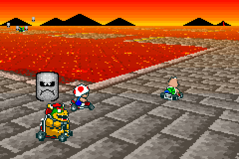
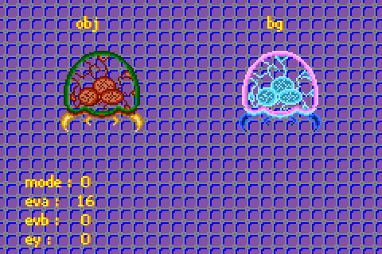
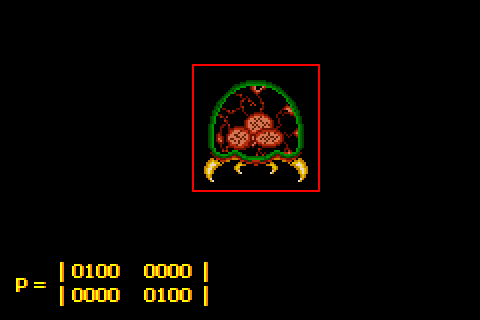

# Rustboy Advance

**Cycle-Aware Game Boy Advance & Game Boy Emulator — Rust `no_std` Core, Desktop (`eframe`/`wgpu`), WebAssembly & Libretro**

> **Accuracy Status:** `gba-core` uses **cycle-aware** CPU, pipeline, prefetch/waitstate, DMA, and timer scheduling alongside a built-in High-Level Emulation (HLE) BIOS and optional real 16 KB GBA BIOS support. It is **not** claimed to be 100% cycle-accurate; see [`TEST_RESULTS.md`](TEST_RESULTS.md) (mirrored in [`docs/TEST_RESULTS.md`](docs/TEST_RESULTS.md)) for current automated pass/fail counts and [`docs/COMPATIBILITY.md`](docs/COMPATIBILITY.md) for commercial database coverage and real-BIOS recommendations.

[](https://www.rust-lang.org)
[](https://www.rust-lang.org)
[](https://webassembly.org)
[](https://github.com/emilk/egui)
[](https://github.com/rust-windowing/winit)
[](https://wgpu.rs)
[](LICENSE)

- **Source Repository:** <https://github.com/jpmasangkay/rustboy-advance>
- **Release Tag:** `v0.1.0`
- **Test Results:** [`TEST_RESULTS.md`](TEST_RESULTS.md) / [`docs/TEST_RESULTS.md`](docs/TEST_RESULTS.md)
- **Compatibility Database:** [`docs/COMPATIBILITY.md`](docs/COMPATIBILITY.md)
- **Changelog:** [`CHANGELOG.md`](CHANGELOG.md)
- **Third-Party Notices:** [`THIRD-PARTY-NOTICES.md`](THIRD-PARTY-NOTICES.md)

---

## Screenshots

Captured directly from the headless release renderer using freely-redistributable MIT-licensed Tonc GBA test ROMs ([Jasper Vijn / `cearn`](scripts/README.md)):

| Tonc Mode 7 Horizon (`m7_ex.gba`) | Tonc Alpha Blending (`bld_demo.gba`) | Tonc Affine Sprites (`obj_aff.gba`) |
| :---: | :---: | :---: |
|  |  |  |

---

## Features

### CPU & Core Emulation (`ARM7TDMI` & `SM83`)
- **ARMv4T execution (`gba-core`)** — 32-bit ARM and 16-bit Thumb instruction sets, 3-stage pipeline modeling, `WAITCNT` prefetch/waitstates, open bus fallback, and cycle-aware 4-channel DMA + 4-stage cascaded timers.
- **Dual BIOS support** — built-in HLE BIOS covering standard SWIs (`Div`, `Sqrt`, `CpuSet`, `CpuFastSet`, `LZ77`, `Huffman`, `RL`, `IntrWait`, `VBlankIntrWait`), plus low-level execution when a user-supplied 16 KB GBA BIOS (`--bios`) is loaded. Titles known to rely on real BIOS open-bus reads or exact SWI timing (`REAL_BIOS_FALLBACK_GAMES`) emit a startup notification recommending a real BIOS dump.
- **Pure `no_std + alloc` core crates** — `gba-core` (`--no-default-features`), `gb-core`, and `gba-debugger` (`--no-default-features`) perform no host filesystem, network, or OS I/O. Optional host timing (`std::time::Instant`) sits behind the `std` feature, while optional experimental Cranelift JIT (`jit` feature) is **disabled by default**.
- **Game Boy / Game Boy Color (`gb-core`)** — `#![no_std]` + `alloc` SM83 CPU, MBC1/2/3(+RTC)/5(+rumble), PPU with STAT blocking, HDMA, and 48 kHz APU.

### PPU, Shaders & Display Filters
- **All GBA video modes** — Mode 0, 1, 2 (text & affine backgrounds), Mode 3, 4, 5 (bitmap modes with page flipping and VRAM unmapped mirroring), 128 sprites (affine transforms, mosaic, double-size, semi-transparency), alpha blending, brightness fades, Windows (`WIN0`, `WIN1`, `WINOBJ`), and `GREENSWAP`.
- **Desktop Display Filters** (`Screen & Sound -> Screen -> Sharpness & Look` and CLI `--filter <slug>`):

| UI Name | `--filter` CLI Slug | Scaling / Behavior |
| :--- | :--- | :--- |
| `Smooth Bilinear` | `smooth-bilinear` | 1x native bilinear |
| `Sharp 1x` | `sharp-1x` | 1x native nearest |
| `xBR 3x` | `xbr-3x` | 3x xBR pixel-art edge scaling |
| `LCD Matrix` | `lcd-matrix` | Authentic LCD pixel grid |
| `Soft LCD` | `soft-handheld` | 2x sharp-bilinear handheld softness |
| `Scale2x` | `scale2x` | 2x EPX / Scale2x smoothing |
| `CRT Scanlines` | `crt-scanlines` | 2x scanline gaps |

- **GPU WGSL Shader Presets (`wgpu`)**: `Nearest`, `SharpBilinear`, `LcdGrid`, `CrtScanlines`, and `ScaleEdge`.
- **Color Profiles**: `AGB-001`, `AGS-101`, `AGS-001`, and `Linear`.
- **Startup Probe & `--no-gpu` Fallback**: Child-process GPU startup probe guards `Metal` / `Vulkan -> DX12 -> GL` initialization, automatically switching to `winit + softbuffer` (`--no-gpu`) if GPU initialization fails or hangs, with adaptive `QualityGovernor` (`<= 720x480` intermediate cap, auto-frameskip fallback, and Win32 `StretchDIBits` on Windows).

### APU & Audio
- **6-channel synthesizer** — bandlimited Blip-buffer square/wave channels, noise channel, Direct Sound A/B DMA FIFOs, 16 Hz DC blocker, 8-tap Blackman-sinc resampler, `cpal` real-time output, and optional `60 Hz` dynamic rate control (DRC) cadence lock.

### Cartridge Hardware, Saves & Patches
- **Backup detection & per-game database** — SRAM 32K, Flash 64K/128K (Panasonic & Sanyo IDs), EEPROM 512B/8K, with curated overrides in `GAME_DB` (`crates/gba-core/src/gamedb.rs`) and per-game UI overrides (`rom_code` + `rom_crc32`).
- **Sensors & Clocks** — GPIO S-3511A RTC (*Pokémon Ruby/Sapphire/Emerald*, *Rockman EXE 4.5*), GBC MBC3 RTC, solar sensor (*Boktai 1–3*, `[` / `]` keys), tilt sensor (*Yoshi's Universal Gravitation*), gyro sensor (*WarioWare: Twisted!*), and rumble (*Drill Dozer*, *WarioWare: Twisted!*).
- **Soft-patching & archives** — inline **BPS**, **UPS**, and **IPS** patching, plus `.zip` and `.7z` ROM loading.
- **Unsupported GBA peripherals (not implemented):** **e-Reader**, **GBA Wireless Adapter**, **Play-Yan**, and **64 MiB GBA Video** bank-switching mappers (`GbaVideo64M` performs size detection only; video bank-switching is not emulated).

### Save States, Rewind, TAS, Cheats, Lua, Debugger & Frontends
- **Versioned Binary Save States (`RBAS` v1 container / `gba-core` `RBAS` v2 payload)** — quick slots `F1–F5` (`Shift+F1–F5` load) and visual state manager (`F6`) storing format version, timestamp, ROM CRC32, game code, LZ4-compressed core state, and PNG thumbnails.
- **Per-Game Settings** — per-ROM overrides (save type, color profile, speed, filter) stored by game code and ROM CRC32.
- **XOR-Delta Rewind & Media Capture** — rolling XOR-delta rewind (`Hold R`), WAV audio capture, and animated GIF recording.
- **TAS Input Movies (`.rbm`)** — `RBMV` v1 binary movie recording and deterministic replay (`rerecord` tracking, initial state embedding).
- **Cheats Engine** — supports **CodeBreaker**, **GameShark / Action Replay v1**, and **Action Replay v3** codes.
- **Lua 5.4 Scripting (`piccolo`)** — sandboxed pure-Rust Lua VM with per-step instruction fuel limits, side-effect-safe memory read/write hooks, joypad injection, and `gui.*` native `240x160` overlays.
- **Debugger & GDB Remote Serial Protocol** — live ARM/Thumb disassembler, breakpoints, callstack tracker, IO register decoder, memory search/freeze, and integrated **GDB RSP server** (default `localhost:2345`, enabled via **Settings -> Developer Tools**).
- **Link Cable & TCP Netplay** — local 2-player split-screen or peer-to-peer TCP socket link cable (default port `27888`; SIO Normal 8-bit, Normal 32-bit, and Multiplayer modes).
- **Libretro Core (`gba-libretro`)** — `libretro.h` v1 C ABI shared library (`rustboy_advance_libretro.dll` / `librustboy_advance_libretro.so` / `librustboy_advance_libretro.dylib`).
- **WebAssembly Frontend (`gba-frontend-web` + `web/`)** — browser build using Canvas / WebGL rendering and AudioWorklet audio output.

---

## Accuracy, Test Suites & Known Issues

Automated accuracy checks run via `gba-testrunner` (comparing framebuffer CRC32 / pass registers) and `gb-core` unit/harness tests. See [`TEST_RESULTS.md`](TEST_RESULTS.md) (and [`docs/TEST_RESULTS.md`](docs/TEST_RESULTS.md)) for full details.

| Runner | Command | Observed Result |
| :--- | :--- | :--- |
| **`gba-testrunner`** | `cargo run --release -p gba-testrunner -- --report TEST_RESULTS.md --fail-on-unexpected` | **58 passed, 0 failed, 2 skipped (missing ROM), 2 skipped (missing golden)** (`62` entries) |
| **`gb-core`** | `cargo test -p gb-core` | **14 passed, 0 failed** (unit tests + optional `test-roms/gb/mooneye/` runner) |

### Known Issues
- **GBA Hardware Edge-Case Coverage:** All `58` runnable suites in `TEST_RESULTS.md` (`JSMolka`, `FuzzARM`, `ARMWrestler`, `nba-hw-test`, `Tonc`, and synthetic stress ROMs) currently pass cleanly. Remaining unverified `GREENSWAP` mid-scanline edge cases not yet covered by automated ROMs remain tracked for future hardware tests.
- **Optional External Test Suites Not Redistributed in Repo:**
  - `mgba/suite.gba`, `ags/ags.gba`, and external `test-roms/gb/mooneye/` ROMs are skipped unless supplied locally (see [`scripts/README.md`](scripts/README.md)).
- **HLE BIOS Timing & Open Bus:** Games checking exact BIOS ROM protected values, checksums, or `SoundDriver` SWI cycles (`REAL_BIOS_FALLBACK_GAMES` in [`docs/COMPATIBILITY.md`](docs/COMPATIBILITY.md)) should be run with a user-provided 16 KB GBA BIOS (`--bios`).
- **Unsupported Cart Add-Ons:** **e-Reader**, **GBA Wireless Adapter**, **Play-Yan**, and **64 MiB GBA Video** bank-switching mappers are not implemented.
- **Commercial Compatibility:** Commercial titles in [`docs/COMPATIBILITY.md`](docs/COMPATIBILITY.md) record verified `GAME_DB` / `REAL_BIOS_FALLBACK_GAMES` configurations, but live commercial playthrough verification is currently **Pending Hardware/Community Verification**.
- **Low-End ARM Benchmarks:** `aarch64` Linux and Apple Silicon builds are cross-checked in CI, but Raspberry Pi / low-power ARM laptop FPS benchmarks have not yet been recorded.

---

## Storage Paths & Portable Mode

By default, persistent data is stored in the OS application data directory rather than next to ROMs or the working directory:
- **Windows:** `%APPDATA%\RustboyAdvance\` (`config.json`, `rustboy_library.cfg`, `saves/`, `states/`, `covers/`, `screenshots/`, `rustboy-crash.log`, `rustboy-startup-error.log`)
- **Linux / macOS:** `$XDG_CONFIG_HOME/RustboyAdvance/` (or `~/.config/RustboyAdvance/`)

To use **Portable Mode** (store everything beside the executable):
- Pass `--portable` on the command line, **or**
- Place an empty `portable.txt` file in the same directory as the `rustboy-advance` executable.

Legacy `.sav` and `.slotN.state` files located directly beside a ROM continue to work as read fallbacks if no file exists yet in `saves/` / `states/`.

To **cleanly uninstall** all persistent emulator data (`config.json`, `rustboy_library.cfg`, `saves/`, `states/`, `covers/`, `screenshots/`, logs, and the OS keyring `retroachievements_token` credential):
- In the desktop app, open **Help -> Uninstall / Delete All App Data...** (or **Settings -> Advanced -> Uninstall / Delete All App Data...**), **or**
- Run `rustboy-advance --uninstall --yes` (or `uninstall.bat` / `uninstall.sh` included in public release builds).

---

## Privacy & Outbound Network Requests

All outbound HTTP requests are **strictly opt-in** (`false` by default) and disabled out of the box:

| Feature | Destination Endpoint | Opt-In Setting / Control | Data Sent | Local Credential Storage |
| :--- | :--- | :--- | :--- | :--- |
| **RetroAchievements** | `https://retroachievements.org/dorequest.php` | Disabled by default (`ra_enabled = false`); enable in **Tools -> RetroAchievements** | RA username & password (on explicit Login) or session token, ROM MD5 hash, unlock & rich-presence pings | Session `ra_token` is stored in the **OS credential store** (`keyring`: Windows Credential Manager / macOS Keychain / Linux Secret Service & keyutils) — **never** serialized into `config.json` |
| **Libretro Box-Art Covers** | `https://raw.githubusercontent.com/libretro-thumbnails/.../Named_Boxarts/...png` | Disabled by default (`auto_download_covers = false`); opt-in checkbox **"Download Covers"** in Library | URL-encoded ROM title to fetch matching box-art PNG | Cached PNG files under `covers/` in AppData / portable directory |

No analytics, telemetry, crash uploads, or background update checks are performed. Netplay (`link.rs`) opens TCP sockets (default port `27888`) only when the user explicitly starts or joins a Link Cable session.

---

## Performance Benchmarks & Optimization Policy

Verified numbers observed on an AMD Ryzen 9 8945HX laptop (`rustc 1.99.1`, release `lto = "fat"`, `codegen-units = 1`, `panic = "abort"`, `strip = "symbols"`; see [`perf/REPORT.md`](perf/REPORT.md)):

| Scenario / Mode | Observed Result |
| :--- | :--- |
| **Headless commercial workload (*Summon Night*, `3,600f`)** | **`1,823.5 FPS`** (`0.453 ms` avg emu time/frame) |
| **Headless `STRESS_SELF` — Auto GPU (`RTX 5070 Vulkan`)** | **`926.1 FPS`** (`15.51x`, `0.888 ms` emu; `1.137 ms` avg / `1.526 ms` p95 windowed frame) |
| **Headless `STRESS_SELF` — `--no-gpu` (`winit + softbuffer`)** | **`1,031.3 FPS`** (`17.27x`, `0.819 ms` emu; `1.066 ms` avg / `1.366 ms` p95 frame) |
| **Headless `STRESS_SELF` — `--software-adapter` (`SwiftShader Vulkan`)** | **`794.4 FPS`** (`13.30x`, `0.844 ms` emu; `1.364 ms` avg / `1.615 ms` p95 frame) |
| **`300 s` `60 Hz` Vulkan Windowed Pacing** | **`17,880 / 17,880` (`100.00%`)** exact `[1v]` DWM scanout frames, **`0` audio underruns** |

- **Raspberry Pi / Low-End Laptops:** Not yet benchmarked on physical ARM / low-TDP hardware; see `aarch64` CI targets and [`perf/REPORT.md`](perf/REPORT.md) for `--selftest` methodology so users can measure on their own machines (`rustboy-advance --selftest`).
- **Dynarec (JIT) & Threaded PPU Policy:** `gba-core` includes an experimental opt-in `cranelift` `jit` feature (disabled by default). Promoting JIT dynarec or multi-threaded PPU rendering to release builds is intentionally deferred until all remaining core accuracy tests pass without regressions.

---

## Minimum System Requirements

| Platform | Minimum Baseline | Recommended |
| :--- | :--- | :--- |
| **OS** | Windows 10/11 (x64), Linux (x86_64 or aarch64), macOS 12+ (Intel or Apple Silicon), or modern browser (WASM + AudioWorklet) | Windows 11 x64 (MSVC release build), Linux (PipeWire/ALSA + Vulkan/Wayland/X11), macOS Apple Silicon |
| **CPU** | 64-bit dual-core x86_64 (baseline SSE2) or ARM64 | Modern quad-core desktop/laptop CPU (AVX2 not required) |
| **Memory** | 256 MB available RAM | 512 MB+ RAM (when using rewind ringbuffer / xBR 3x) |
| **Graphics** | Any Vulkan / DirectX 12 / Metal / OpenGL 3.3+ GPU, **or** CPU-only software presentation (`--no-gpu`) | Vulkan / DX12 / Metal GPU for WGSL shaders and minimal CPU overhead |

---

## Getting Started & Release Builds

### Workspace Crates

| Crate | Purpose |
| :--- | :--- |
| `gba-core` | `#![cfg_attr(not(feature = "std"), no_std)]` + `alloc` GBA core (ARM7TDMI, PPU, APU, Bus, Cartridge, DMA, Timers) |
| `gb-core` | `#![no_std]` + `alloc` DMG / CGB core (SM83, MBC, PPU, APU) |
| `gba-debugger` | `#![cfg_attr(not(feature = "std"), no_std)]` ARM/Thumb disassembler, breakpoints, callstack, IO decoder, GDB RSP stub |
| `gba-frontend-desktop` | Desktop GUI (`eframe`/`egui`/`wgpu`/`winit`+`softbuffer`/`cpal`/`gilrs`), Lua (`piccolo`), RetroAchievements (`keyring`), Netplay, `.rbm` TAS |
| `gba-frontend-web` | WebAssembly bindings for `web/` (Canvas/WebGL + AudioWorklet) |
| `gba-libretro` | Libretro v1 C ABI core (`gba_libretro.dll` / `.so` / `.dylib`) |
| `gba-testrunner` | Automated headless test runner generating [`TEST_RESULTS.md`](TEST_RESULTS.md) |

### CLI Usage & Headless Harness

```bash
# Launch desktop UI (Windows release builds attach to parent console only for CLI flags)
rustboy-advance

# Launch directly into a ROM (or use portable mode)
rustboy-advance "path/to/game.gba" --portable --bios "path/to/gba_bios.bin"

# Cleanly delete all persistent emulator data, saves, states, covers, and credentials
rustboy-advance --uninstall --yes

# Headless deterministic test run with CRC32 & screenshot dump
rustboy-advance "path/to/rom.gba" --headless --frames 120 --fb-crc32 --screenshot frame.ppm

# Force pure-CPU winit+softbuffer renderer (or retry GPU probing after a driver update)
rustboy-advance --no-gpu "path/to/game.gba"
rustboy-advance --retry-gpu

# Self-contained performance & GPU/software-fallback benchmark
rustboy-advance --selftest

# List all supported CLI options or print version
rustboy-advance --help
rustboy-advance --version
```

### Automated Test Runner

```bash
# Fetch freely-redistributable test suites locally (not committed to git)
./scripts/fetch-test-roms.sh    # Windows: .\scripts\fetch-test-roms.ps1

# Run full automated suite and regenerate TEST_RESULTS.md
cargo run --release -p gba-testrunner -- --report TEST_RESULTS.md --fail-on-unexpected
```

### Reproducible Clean Release Builds, Path Stripping & PGO

1. **Toolchain & Path Stripping (`--remap-path-prefix`):**
   - For Windows releases, the `x86_64-pc-windows-msvc` target is recommended over `windows-gnu` for native PDB compatibility and lower unsigned antivirus false positives (CI release builds in [`.github/workflows/release.yml`](.github/workflows/release.yml) use `x86_64-pc-windows-msvc`).
   - Remap local `CARGO_HOME`, `RUSTUP_HOME`, sysroot, and workspace paths via `CARGO_ENCODED_RUSTFLAGS` (unit-separator `\x1f`, which handles spaces in paths cleanly) so user home directories are not embedded in panic/bounds-check strings:
     ```bash
     # Unix (Linux / macOS)
     SEP=$'\x1f'
     export CARGO_ENCODED_RUSTFLAGS="--remap-path-prefix=${CARGO_HOME:-$HOME/.cargo}=/cargo${SEP}--remap-path-prefix=${RUSTUP_HOME:-$HOME/.rustup}=/rustup${SEP}--remap-path-prefix=$(rustc --print sysroot)=/rustc${SEP}--remap-path-prefix=${PWD}=/workspace"
     cargo build --release -p gba-frontend-desktop
     cargo build --profile libretro -p gba-libretro
     ```
2. **Optional Profile-Guided Optimization (`cargo-pgo`):**
   - Interpreter emulation loops benefit measurably from PGO on top of `lto = "fat"` + `codegen-units = 1`:
     ```bash
     cargo pgo instrument build -- -p gba-frontend-desktop
     ./target/x86_64-pc-windows-msvc/release/rustboy-advance.exe --selftest
     cargo pgo optimize build -- -p gba-frontend-desktop
     ```
3. **Archive Hygiene & Checksums:**
   - Release archives publish `SHA256SUMS.txt` alongside binaries. On Windows, package archives with `tar.exe -a -cf` (not PowerShell `Compress-Archive`) so entries use forward slashes (`/`) for clean extraction on Linux and macOS.

### Libretro Core (RetroArch)

```bash
# Build the shared library (`librustboy_advance_libretro.{so,dylib}` / `rustboy_advance_libretro.dll`)
cargo build --release -p gba-libretro
```

See [crates/gba-libretro/README.md](crates/gba-libretro/README.md) for RetroArch installation instructions and [`rustboy_advance_libretro.info`](crates/gba-libretro/rustboy_advance_libretro.info).

### WebAssembly (WASM) Web Frontend

```bash
cargo build --target wasm32-unknown-unknown --release -p gba-frontend-web
wasm-bindgen --target web --out-dir web/pkg target/wasm32-unknown-unknown/release/gba_frontend_web.wasm
node web/server.js
```

---

## Controls & Hotkeys

| GBA Button | Player 1 | Player 2 (Local Link) |
| :--- | :--- | :--- |
| D-Pad (`Up/Down/Left/Right`) | `Arrows` | `I / K / J / L` |
| `A` / `B` | `Z` / `X` | `O` / `U` |
| `L` / `R` | `Q` / `E` | `7` / `8` |
| `Start` / `Select` | `Enter` / `Backspace` | `N` / `M` |
| Turbo `A` / Turbo `B` | `V` / `C` | — |

| **Boktai Solar Sensor (- / +)** | `[` / `]` |
Game inputs and gamepad bindings (`gilrs`) are customizable under **Settings -> Controls** or **Help -> Controls Cheat-Sheet**.

### Hotkeys & Shortcuts

| Action | Shortcut |
| :--- | :--- |
| **Open ROM** | `Ctrl+O` (`Cmd+O` on macOS) |
| **Return to Library** | `Ctrl+W` (`Cmd+W` on macOS) |
| **Pause Overlay / Close Dialog / Exit Fullscreen** | `Esc` |
| **Pause / Resume** | `Space` |
| **Rewind Gameplay** | Hold `R` |
| **Fast Forward (Turbo)** | Hold `Tab` |
| **Toggle Fullscreen** | `F11` |
| **Visual Save State Manager** | `F6` |
| **Quick Save State (Slots 1–5)** | `F1`–`F5` |
| **Quick Load State (Slots 1–5)** | `Shift+F1`–`Shift+F5` |
| **Undo Last Save / Load Action** | `Ctrl+Z` (`Cmd+Z` on macOS) |
| **Advance Single Frame** | `Ctrl+N` |
| **Restart Game (Hard Reset)** | `Ctrl+R` |
| **Mute / Unmute Audio** | `Ctrl+M` |
| **Take Screenshot** | `F12` |
| **Toggle Menu Bar** | `Ctrl+Shift+M` |
| **Toggle Action Toolbar** | `Ctrl+T` |
| **Toggle Status Bar** | `Ctrl+S` |
| **Boktai Solar Sensor (- / +)** | `[` / `]` |

---

## License, Source Availability & Acknowledgements

- **License:** Mozilla Public License 2.0 ([`LICENSE`](LICENSE)). Under MPL-2.0, complete corresponding source code is published at <https://github.com/jpmasangkay/rustboy-advance> (tag `v0.1.0`).
- **Third-Party Notices & Attributions:** Statically linked Rust crate licenses (`Cargo.lock`), embedded fonts, and external test-ROM licenses (including Jasper Vijn's MIT-licensed Tonc demos) are listed in [`THIRD-PARTY-NOTICES.md`](THIRD-PARTY-NOTICES.md).
- **Author:** John Paul Masangkay ([@jpmasangkay](https://github.com/jpmasangkay)) — with thanks to Martin Korth (GBATEK), Vicki Pfau & mGBA, Jonas Smolka, DenSinH (FuzzARM), fleroviux (NanoBoyAdvance), Matt Currie, Joonas Javanainen (Gekkio), Shay Green (Blargg), and Jasper Vijn (`cearn`).
